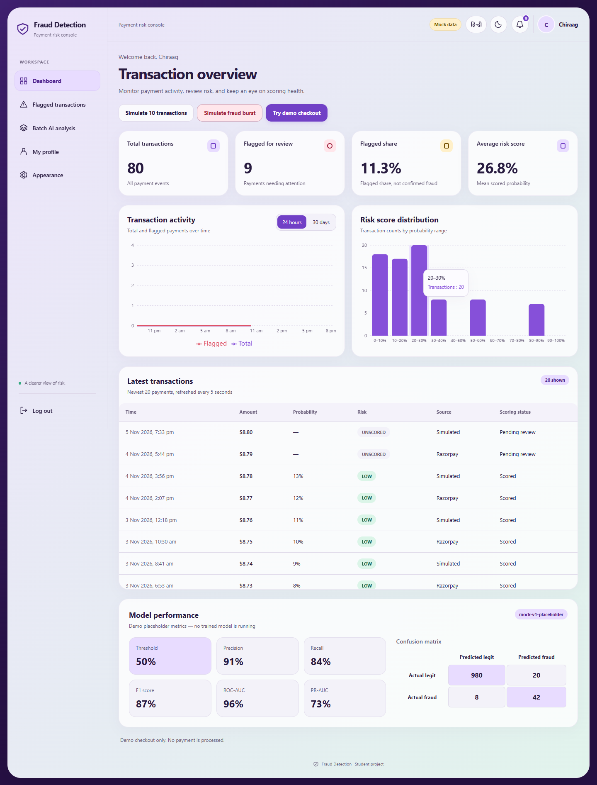
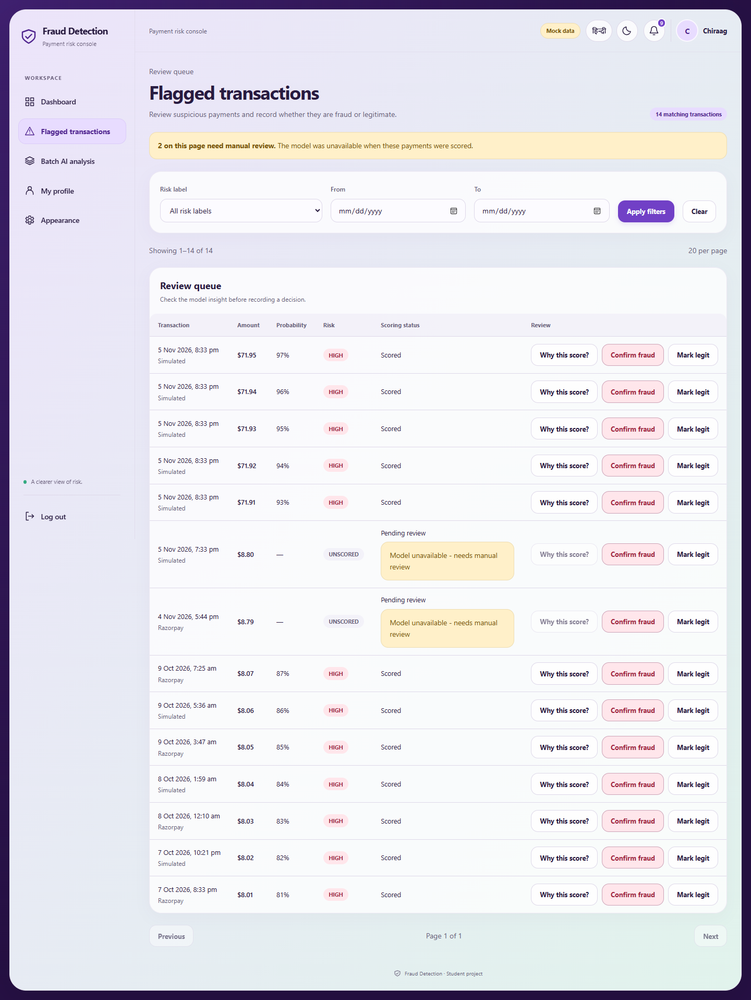
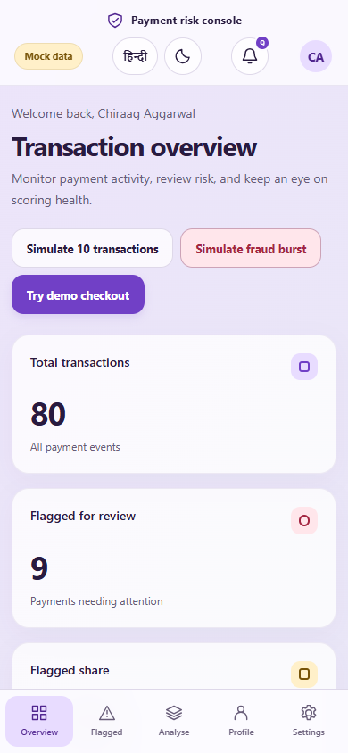
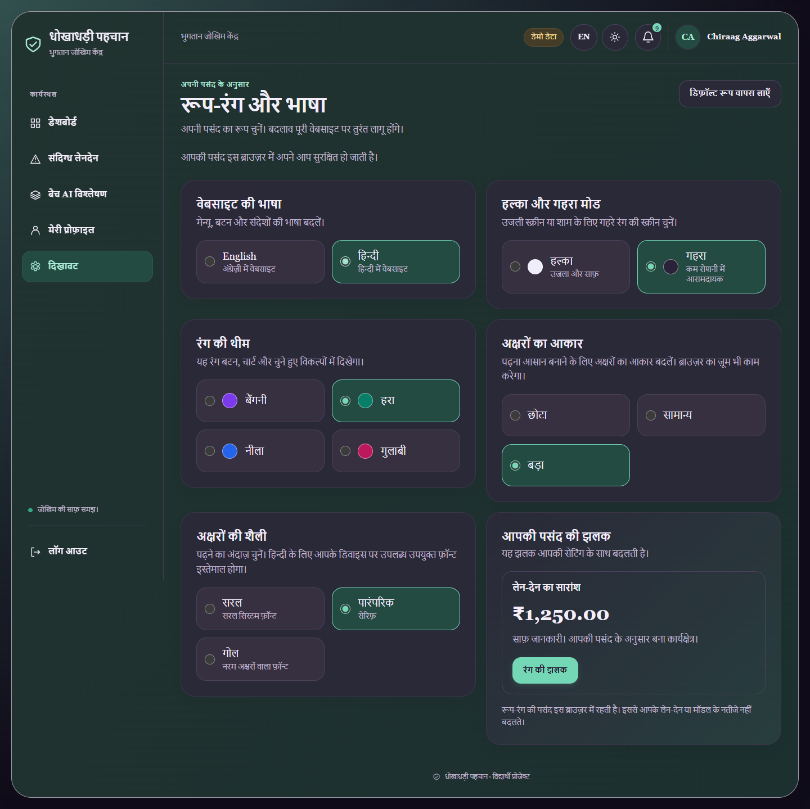

# Credit Card Fraud Detection

A student project for analysing transaction risk, reviewing suspicious activity, and understanding a trained machine-learning model. It combines a React dashboard, a Python API, PostgreSQL, and a separate Python model service.

[Public dashboard](https://credit-card-fraud-detection-demo.onrender.com/)

The existing public dashboard remains a mock demo until the updated services are deployed. The new deployment configuration uses the real API and PostgreSQL with mock mode off. Razorpay checkout stays disabled until credentials are configured.

## Features

- Registration, login, protected routes, and editing your own name/email.
- Dashboard totals, flagged share, average score, activity chart, and histogram.
- Latest transactions refreshed every five seconds; alerts every 15 seconds.
- Flagged transactions with date/risk filters, pagination, and manual decisions.
- Historical simulation using genuine dataset rows and the trained model.
- CSV batch analysis of up to 100 compatible rows and model explanations.
- Model version, threshold, precision, recall, F1, ROC-AUC, PR-AUC, and confusion matrix.
- English/Hindi, light/dark mode, four themes, font choices and text sizes.
- Full-width desktop layout and responsive phone navigation.
- PostgreSQL persistence, migrations, user scoping, review audits and payment uniqueness.
- Razorpay server-created orders, signature verification and retry-safe payment notifications.

## Screenshots

### Dashboard



### Flagged transactions



### Phone layout



### Hindi and dark mode



Screenshots show the interface; transaction data depends on the selected mode.

## Architecture

```text
React dashboard -> Python FastAPI API -> PostgreSQL
                            |-> Python model service
                            |-> Razorpay, when enabled
```

| Folder | Purpose |
| --- | --- |
| client/ | React, Vite, Tailwind, Axios, Recharts, optional mock adapter |
| server/ | Active FastAPI API, SQLAlchemy/PostgreSQL, JWT and Razorpay |
| server/migrations/ | Versioned database migrations |
| server/scripts/ | Schema setup and optional MongoDB import |
| ml-service/ | Model, prediction API, training and evaluation |
| docs/API_CONTRACT.md | Exact API routes and JSON shapes |
| render.yaml | Three-service Render deployment configuration |

The old Express implementation remains in server/legacy-express/ for reference. Do not deploy it.

## What the AI results mean

The model uses the historical ULB/Kaggle dataset: Time, V1–V28, and Amount. Training splits data before fitting/resampling, compares logistic regression and XGBoost, selects the threshold using validation data, and evaluates on a held-out test split. Isolation Forest is a research baseline.

The saved XGBoost model's held-out results are precision **0.8300**, recall **0.8384**, F1 **0.8342**, ROC-AUC **0.9700**, and PR-AUC **0.8652**. Its confusion matrix is `[[56846, 17], [16, 83]]` and threshold is about **0.0795**. These describe historical data, not current merchant payment performance. See [the model guide](ml-service/README.md).

Razorpay does not provide the dataset's anonymous PCA features. Captured payments are saved with their actual amount/provider IDs, **null probability**, and **UNSCORED / pending review**. They receive no invented sample score. Manual review records a person's decision; it does not stop or reverse a captured payment.

Simulation uses labelled historical samples and remains marked simulated. Batch analysis does not persist uploaded rows. Automatic scoring of new real payments still requires a separately validated model trained on available payment features and labelled outcomes.

## Run locally with real storage

Use Node.js 22, Python 3.12 and PostgreSQL 17 or later.

1. Create a PostgreSQL database. Copy server/.env.example to server/.env. Fill DATABASE_URL, a random JWT_SECRET of at least 32 characters, CLIENT_URL=http://localhost:5173, ML_SERVICE_URL=http://localhost:8000, and ML_API_KEY. Keep payment flags false.
2. In a terminal inside ml-service/, run:

```powershell
py -3.12 -m venv .venv
.\.venv\Scripts\Activate.ps1
python -m pip install --upgrade pip==26.2
python -m pip install -r requirements.txt
$env:ML_API_KEY = '<the same key used by the API>'
uvicorn app.main:app --host 127.0.0.1 --port 8000
```

3. In another terminal inside server/, run:

```powershell
py -3.12 -m venv .venv
.\.venv\Scripts\Activate.ps1
python -m pip install --upgrade pip==26.2
python -m pip install -r requirements.txt
python scripts/migrate_database.py
uvicorn app.main:app --host 127.0.0.1 --port 5000
```

4. In a terminal inside client/, run:

```powershell
npm ci
Copy-Item .env.example .env
npm run dev
```

The client example uses VITE_API_URL=http://localhost:5000 and VITE_USE_MOCK=false. Open http://localhost:5173, register, and use Simulate or Batch AI analysis. New databases start empty. Both Python /health endpoints should succeed first.

Alternatively, [Docker Compose](docker-compose.yml) runs PostgreSQL, API and ML locally; run the client separately. Set its required secrets before `docker compose up --build`. Docker execution has not been verified on the Windows development machine.

## Deploy

Follow [the deployment guide](docs/DEPLOYMENT.md):

**PostgreSQL -> ML service -> Python API -> React static site -> smoke tests.**

The Render Blueprint supplies real-mode frontend settings, health checks, migrations and a shared ML key. You supply the database connection and public URLs. It creates no paid database and enables no real payments. Free services sleep when idle and are suitable for a demonstration, not an availability guarantee for real-money operations.

Build-time VITE_ variables are public. Keep database passwords, JWT secrets, Razorpay secrets and the ML key exclusively on backend services. Rebuild the frontend after API URL/mock setting changes.

For existing MongoDB records, follow the preview-first [PostgreSQL migration and backup guide](docs/POSTGRESQL.md). It never deletes the source. Old payment sample scores are explicitly cleared during import; preserve an original backup.

## Razorpay

Payments start disabled. When test credentials are available, add them only on the API, set PAYMENTS_ENABLED=true and keep ALLOW_LIVE_PAYMENTS=false. Configure the payment.captured webhook at `<API URL>/api/webhooks/razorpay` with a matching secret. Test mode moves no real money.

Live payments require Razorpay approval, live credentials, deliberate activation, operational testing and appropriate policies. Automatic refunds/disputes and live fraud prevention are outside this release.

## Mock mode and preferences

Set VITE_USE_MOCK=true only for a frontend demonstration. Mock responses need no database/model/provider. Example scores are fictional; demo checkout processes no payment. Real builds omit the mock implementation.

Appearance/language settings are browser-local. Mock profiles are browser-local; real profiles are in PostgreSQL. Mock and real tokens use separate storage keys, so switching modes requires signing in again. Transactions/reviews survive restarts only through the real API/database.

## Verification

See [testing instructions](docs/TESTING.md). CI checks the frontend, API against PostgreSQL, and ML service on pushes and pull requests. Tests exercise the saved model, migrations, account isolation, reviews and mocked Razorpay verification/retries. They never make an actual charge.
