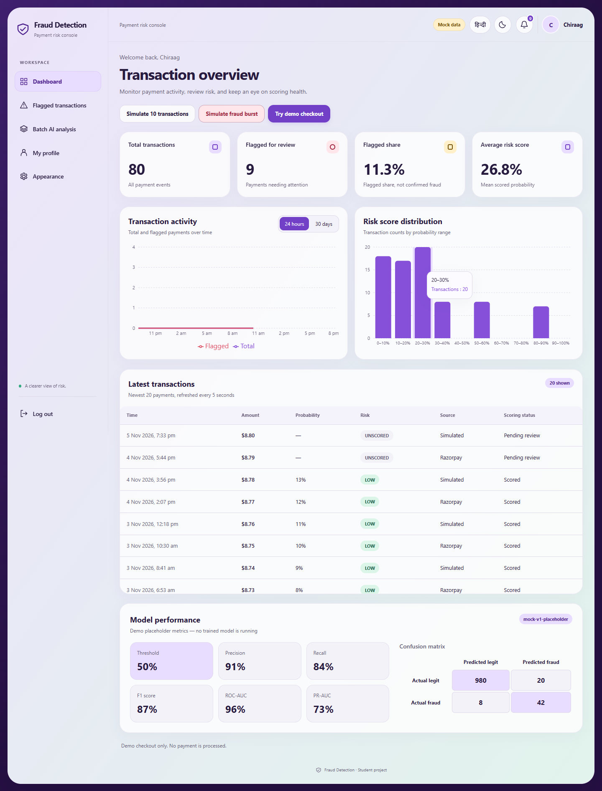
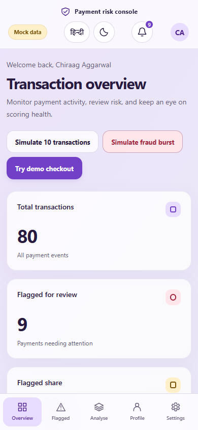
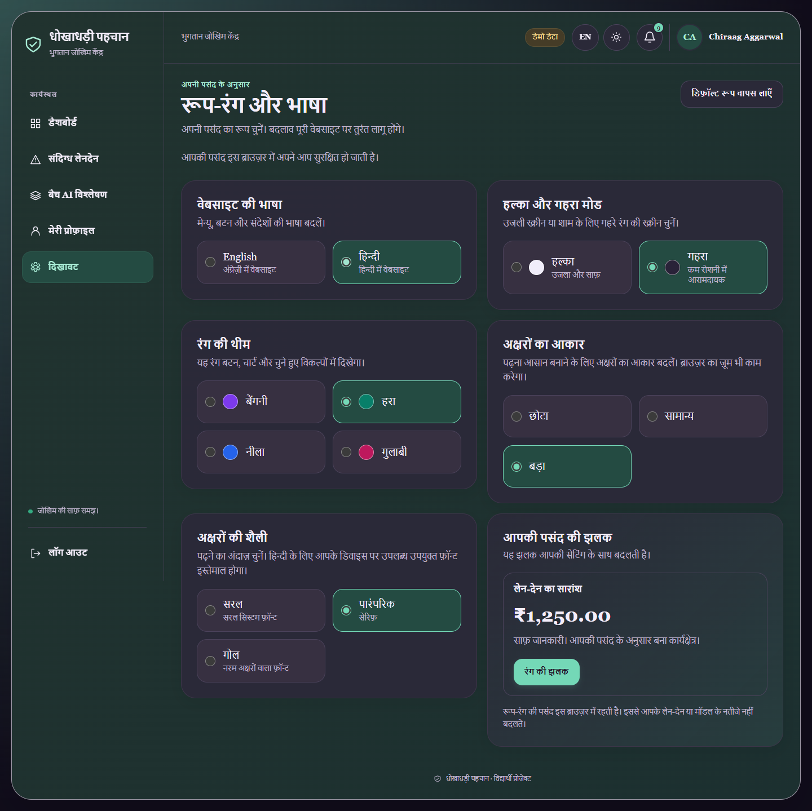

# Payment Risk Console

A full-stack credit-card fraud monitoring demo. Merchants can review transaction activity, inspect model risk scores, and manually review flagged payments from a single dashboard. The interface uses soft lavender and mint colours, rounded cards, readable charts, and layouts designed for both computers and phones.

> **Demo mode:** The public site currently runs with mock data. Account actions, transactions, and checkout are simulated in the browser. No payment is processed, and mock model metrics are illustrative only.

## Live demo

[Open the dashboard](https://credit-card-fraud-detection-demo.onrender.com/)

The Render static site uses `VITE_USE_MOCK=true`, so it works without a live API, database, or payment provider.

## Screenshots

The images below show the redesigned project build. Changes appear on the public site after its Render deployment succeeds.

### Desktop dashboard

The dashboard shows transaction totals, flagged activity, risk charts, model metrics, and demo actions.



[View the redesigned flagged-transaction review screen](docs/screenshots/flagged-desktop.png).

### Phone layout

Cards stack on small screens, transaction rows become easy-to-read cards, and bottom navigation keeps the main pages within reach. The same review, analysis, profile, and appearance features are available on a phone.



### Hindi and dark mode

Users can choose Hindi or English and adjust the colours, brightness, text size, and font from Appearance settings.



## What the project includes

- **React dashboard:** Login and registration screens, a protected overview page, a flagged-transaction review page, a batch AI analysis screen, profile editing, and appearance settings.
- **Desktop and phone layouts:** A sidebar on larger screens, bottom navigation on phones, responsive charts, and compact transaction cards that keep review controls usable on small screens.
- **English and Hindi:** Change the interface language without signing out. Navigation, forms, settings, risk labels, and status messages use the selected language; model feature names such as `V14` stay unchanged.
- **Personal appearance:** Light or dark mode; lavender, mint, ocean, or rose colour themes; small, medium, or large text; and system, serif, or rounded fonts. Choices are remembered in the current browser.
- **Editable profile:** Update your name and sign-in email with validation and duplicate-email checks. Your password, role, and user ID stay the same, and changing your email keeps the current session signed in.
- **Transaction monitoring:** KPI cards, a 24-hour/30-day activity chart, a risk-score histogram, and a transaction table that refreshes every five seconds.
- **Review workflow:** Filter and page through flagged payments, then record a fraud or legitimate decision. Transactions the model could not score are marked for manual review.
- **Model information:** Shows the model version, decision threshold, precision, recall, F1, ROC-AUC, PR-AUC, and confusion matrix.
- **Explainable AI:** Reviewers can inspect the strongest feature contributions behind a scored flag. XGBoost explanations use TreeSHAP; logistic regression uses exact coefficient contributions. Mock mode labels its examples clearly.
- **Batch AI analysis:** Upload a CSV and score up to 100 rows with the trained model. The analyzer ignores any `Class` label, returns only scores and risk labels, and does not save the uploaded rows.
- **Alerts:** A navbar bell shows the number of unread flagged transactions and refreshes every 15 seconds.
- **Mock mode:** An Axios adapter supplies demo responses while keeping the same API calls as the real backend. Transactions are held in memory; demo profiles are remembered in browser storage. The public demo's checkout is only a confirmation message; no payment is processed.
- **Python API:** FastAPI, JWT authentication, MongoDB persistence, transaction queries/statistics, fraud scoring, explanations, simulation, review, alerts, and Razorpay test checkout plus verified webhooks.
- **Python ML service:** A FastAPI service loads the trained model artifacts and exposes health, model-info, single and batch prediction, and local explanation endpoints. The training pipeline compares four supervised approaches and an Isolation Forest baseline, selects a model and precision-aware threshold using validation data, and evaluates the held-out test set.

## How it is organized

| Folder | Purpose |
| --- | --- |
| `client/` | React 19, Vite, Tailwind CSS, Recharts, and the mock API adapter |
| `server/` | Active FastAPI API, MongoDB/PyMongo, JWT auth, fraud routes, and Razorpay payments. `server/legacy-express/` keeps the old Express version as a rollback reference. |
| `ml-service/` | FastAPI prediction service, model training scripts, tests, and saved model artifacts |
| `docs/API_CONTRACT.md` | The shared source of truth for API paths and JSON request/response shapes |

### Request flow

```text
React dashboard  ->  FastAPI API  ->  MongoDB
                           |        ->  FastAPI model service
                           |        ->  Razorpay test checkout / webhook
                           |
                    Axios mock adapter
                    (when VITE_USE_MOCK=true)
```

The mock adapter lets the frontend demo run before the API is available. Switch to real requests by setting `VITE_USE_MOCK=false` and configuring the API URL.

## Profile and appearance settings

Open **Profile** to change your name or email, save your changes, or log out. After an email change, use the new email with your existing password the next time you sign in. Open **Appearance** to change language, light/dark mode, colour theme, text size, or font family. Changes appear immediately; the reset button restores the default appearance.

| Information | Where it is saved | What to expect |
| --- | --- | --- |
| Language and appearance choices | This browser's local storage | Survive refreshes and logout. They do not sync to another device or account. |
| Profile in mock mode | This browser's local storage | Saves demo name, email, user ID, and role; no passwords are stored. This does not create or edit a real backend account. |
| Transactions and review decisions in mock mode | Browser memory | Reset when the app reloads. Mock scores and model metrics are illustrative. |
| Profile with the real API enabled | MongoDB through authenticated `PATCH /api/auth/me` | Saves the signed-in user's name and email. Other users' profiles cannot be changed through this endpoint. |

Clearing this site's browser data resets local appearance settings and demo profiles. If the browser blocks storage, appearance and demo changes can only last for the current in-memory session. Mock login accepts any password of at least eight characters; use the real API for actual account authentication.

## Run the frontend demo locally

You need Node.js and npm. In PowerShell:

```powershell
cd client
npm install
Copy-Item .env.example .env
```

Edit `client/.env` to use mock mode:

```env
VITE_API_URL=http://localhost:5000
VITE_USE_MOCK=true
```

Then start Vite:

```powershell
npm run dev
```

Open the local URL printed by Vite (usually `http://localhost:5173`). In mock mode, registration accepts a password with at least 8 characters and no backend account is created. Demo transactions are generated by the mock API.

## Run the full stack locally

The full stack needs a MongoDB database, the Python API, the Python ML service, and Razorpay **test-mode** credentials to exercise checkout. Keep all secrets in local `.env` files; never commit them.

### 1. Start the ML service

Use Python 3.12 or newer, then from the repository root:

```powershell
cd ml-service
py -3.12 -m venv .venv
.\.venv\Scripts\Activate.ps1
python -m pip install -r requirements.txt
uvicorn app.main:app --reload --port 8000
```

The model file and metadata are under `ml-service/artifacts/`. The original training CSV is not included in the repository. See [the ML service guide](ml-service/README.md) to fetch or supply the dataset and reproduce training.

### 2. Configure and start the API

Copy `server/.env.example` to `server/.env` and fill in your own values:

```env
PORT=5000
MONGODB_URI=<your MongoDB connection string>
JWT_SECRET=<random secret with at least 32 characters>
CLIENT_URL=http://localhost:5173
ML_SERVICE_URL=http://localhost:8000
ML_TIMEOUT_MS=60000
RAZORPAY_KEY_ID=rzp_test_<your test key id>
RAZORPAY_KEY_SECRET=<your Razorpay test key secret>
RAZORPAY_WEBHOOK_SECRET=<your Razorpay test webhook secret>
ALLOW_LIVE_PAYMENTS=false
```

From inside `server/`, the copy command is `Copy-Item .env.example .env` in PowerShell.

`MONGODB_DATABASE` and `ML_API_KEY` are optional. Keep `ALLOW_LIVE_PAYMENTS=false` for this demo. Start the API in a separate terminal:

```powershell
cd server
py -3.12 -m venv .venv
.\.venv\Scripts\Activate.ps1
python -m pip install -r requirements.txt
uvicorn app.main:app --reload --port 5000
```

### 3. Point the client at the API

Set `VITE_API_URL=http://localhost:5000` and `VITE_USE_MOCK=false` in `client/.env`, then run `npm run dev` from `client/`. Restart Vite after changing environment variables.

## API reference

See [docs/API_CONTRACT.md](docs/API_CONTRACT.md) for the exact endpoints and JSON shapes. The main routes cover:

- Authentication: `/api/auth/register`, `/api/auth/login`, `GET /api/auth/me`
- Profile updates: `PATCH /api/auth/me` with `{name, email}`
- Transactions: list, statistics, score histogram, simulation, and review under `/api/transactions`
- Payments: `/api/payments/checkout-session`
- Payment confirmation and webhooks: `/api/payments/verify`, `/api/webhooks/razorpay`
- Model and alerts: `/api/model-info` and `/api/alerts/unread-count`

## Deployment

The public demo is a Render **Static Site** built from `client/`:

- Root directory: `client`
- Build command: `npm install && npm run build`
- Publish directory: `dist`
- Environment variable: `VITE_USE_MOCK=true`

In the static site's **Redirects/Rewrites** settings, add this rule so refreshing or directly opening a page such as `/flagged`, `/profile`, or `/settings` works:

| Source | Destination | Action |
| --- | --- | --- |
| `/*` | `/index.html` | **Rewrite** |

This serves the React app while preserving the requested URL. See [Render's rewrite guide](https://render.com/docs/redirects-rewrites).

Deploying with mock mode keeps the public site independent of backend secrets and does not enable payments. Rebuild the static site after source or `VITE_` environment changes. Keeping `VITE_USE_MOCK=true` enables the new demo profile and appearance screens without deploying a backend.

For a real API connection, deploy the current Python API as a separate Render **Web Service**:

- Root directory: `server`
- Python version: `3.12`, selected by the included `.python-version` file. If overriding it with Render's `PYTHON_VERSION` variable, use a complete released `3.12.x` version, including its patch number; see [Render's Python version guide](https://render.com/docs/python-version).
- Build command: `pip install -r requirements.txt`
- Start command: `uvicorn app.main:app --host 0.0.0.0 --port $PORT`
- Configure `MONGODB_URI`, a `JWT_SECRET` of at least 32 characters, `CLIENT_URL` set to the frontend's exact origin, and `ML_SERVICE_URL`. Add the matching `ML_API_KEY` if the ML service requires one. Configure Razorpay test credentials only when using test checkout.

The Python service must include the new `PATCH /api/auth/me` route before profile editing can save to MongoDB; updating only the frontend does not add backend endpoints. Check the API's `/health` endpoint, then set the client's `VITE_API_URL` to that API URL and `VITE_USE_MOCK=false`, and rebuild the frontend. The ML service is deployed separately from `ml-service/`; see [its setup guide](ml-service/README.md).

Configure the Razorpay **test-mode** webhook at `<API URL>/api/webhooks/razorpay` for `payment.captured`. Keep `ALLOW_LIVE_PAYMENTS=false` unless the project is approved for live payments and you intentionally switch credentials.
